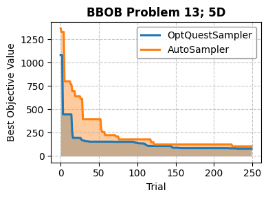
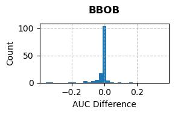
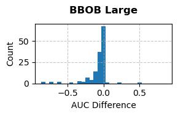
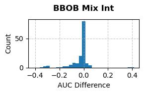
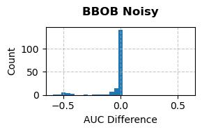
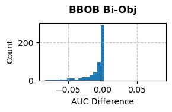
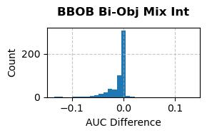
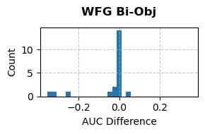
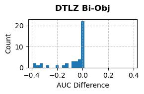
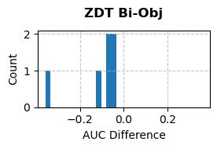

## Abstract

OptQuest is a black-box optimization engine from OptTek Systems, Inc., which has developed it since 1998. You declare the decision variables, the constraints and one or more objectives. The engine proposes values for the variables, your code evaluates them and returns the results, and the engine uses those results to propose the next values. The engine does not need gradients or a formula for the objective, and it does not assume that the objective is convex or smooth. The search combines linear and mixed-integer programming, a design of experiments, scatter search (a reference set of the best trial solutions, combined into new ones), local search, enumeration of small domains, and a Kriging metamodel. In one model you can use continuous, integer, discrete, categorical and permutation variables, the special purpose and structured variable types listed in [Coverage](#coverage-and-known-limitations), constraints on inputs and outputs, and one or more objectives.

## Commercial License

The OptQuest library can be used in conjunction with Optuna in demo/evaluation mode without a commercial license key. This mode is provided solely for testing, evaluation, and demonstration purposes. Any use in production environments, commercial deployments, or for generating results intended for business decision-making requires a valid commercial license key.

For licensing inquiries, purchasing a commercial license, obtaining a license key, or requesting additional information, please contact:

OptTek Systems, Inc.

Email: info@opttek.com

Website: https://www.opttek.com/optquest/

## APIs

> [!NOTE]
> The `OptQuestSampler` requires binaries that are not distributed on OptunaHub. Install the `optquest` python package, version 10.2.0.0 or newer, separately from PyPI: `pip install -U optquest`. With an older `optquest`, loading the sampler raises `ImportError`.
>
> The `optquest` package includes engine binaries for Windows (x86-64) and Linux (x86-64) only. macOS is not supported: `pip install optquest` succeeds there, but the engine cannot be loaded, so `OptQuestSampler` fails when it creates its model.

`OptQuestSampler(model=None, search_space=None, directions=None, seed=None, license='', statements=None)`

Exactly one of the following must be provided to define the optimization:

- `model`: a fully defined `OptQuestModel` (the typed, method-call API, `model.add_continuous_variable(...)`, etc). The sampler recovers its search space from the model's own `describe()` output, so it supports every variable type below, including `MIXTURE`. It refuses what it cannot take (see [What the sampler does not support](#what-the-sampler-does-not-support)) before it initializes the model, so that you can still change the model. A non-empty `license` is set on the model; an empty one leaves the license that you set on the model. When `license` or `seed` would give the engine another key or seed than the one that you set on the model, the sampler raises `ValueError`, as it does for a `LICENSE` or `RANDOMSEED` statement in `statements`.
- `search_space` + `directions`: plain Optuna primitives, a distributions dict and a list (or tuple) of `optuna.study.StudyDirection` or the strings `"minimize"`/`"maximize"`. The simplest way to get started; only scalar (continuous/integer/discrete/categorical) variables are possible in this mode, because Optuna has no richer distribution types. A parameter name that the engine cannot take (a name with whitespace or a semicolon, one that starts with a digit or holds a non-ASCII character, a function or constant name of the OptQuest expression language such as `e`, `max` or `rate`, a name that differs only by case from another, or the name of one of the sampler's own outputs and objectives, `OQout00`, `OQobj00`, ...) gets an internal name in the engine; `trial.params` keeps your names. Each bound of an `IntDistribution` or a `FloatDistribution` must be from -2\*\*50 to 2\*\*50 (1125899906842624), because the engine refuses a larger bound; the sampler raises `ValueError` that names the parameter for another one. A log-scale distribution has no such limit, because the engine gets the log of its bounds, but each bound must be a number that a float can hold. A stepped `FloatDistribution` whose `low` and `high` the engine takes for one value, because they are within 1e-5 of each other, raises `ValueError` (see `DISCRETE` in [What your function receives](#what-your-function-receives-for-sequence-policy-sequence-selection-angle-discrete-and-dag-variables)).
- `statements`: a list of emitter statement dicts (`[{"cmd": "CONTINUOUS", "name": "x", "min": -5, "max": 5}, {"cmd": "DAG", "name": "flow", "nodes": [...]}, ...]`), the **recommended way to use OptQuest's advanced variable types**. Every variable, output, expression, constraint, objective and run-setting command (container/vector/matrix variables; permutations; special purpose variables like mixtures, sequences, assignments, partitions, DAGs, paths, ...) is supported declaratively, with no per-type code required, except the commands in [What the sampler does not support](#what-the-sampler-does-not-support). The sampler first checks the list with `optquest.emit_model()` and `optquest.check_model()`, so an unknown command, a misspelled or missing field, a value of the wrong type, a reserved name, bounds in the wrong order (`min` and `max`, `k_min` and `k_max`, ...), or a member of a group or the variable of an `EXCLUSIVE` range that no earlier statement declares raises `optquest.EmitError` (a `ValueError`) that names the statement. The engine checks the names in an expression (`EXPRESSION`, `CONSTRAINT`), names that differ only by case, and a few bounds that `emit_model()` does not compare (the `min_theta_deg` and `max_theta_deg` of a `SPHERICALANGLE`, the `bin_cap_min` and `bin_cap_max` of an `ASSIGNMENT`) when the sampler builds and initializes the model; a problem there raises `RuntimeError` with the engine's message. The sampler checks the expression of an `OBJECTIVE` itself, before it builds the model: one name that is not a declared output (a misspelled output, for example) raises `ValueError` (see [What the sampler does not support](#what-the-sampler-does-not-support)). A field can hold a numpy array or number, an int field can hold a whole float or a numeric string (`30.0` or `"30"`), and an item, node or task name can be a number (`"items": [0, 1, 2]`), as `emit_model()` accepts them; the sampler takes such a name as text (`"0"`), as `emit_model()` writes it. The predecessors of a task or a node, and the required nodes of a `PATH`, can be any collection of names, such as a set: the sampler takes the names in the order in which the collection gives them, as `emit_model()` writes them. A few values that `emit_model()` accepts raise `ValueError` that names the statement, because the model cannot take them: rows of different lengths in a table (`tuples`, `coords`, `vertices`, `matrix`, `initial`), a `GEOLOCATION` row that is not a pair, a `REGION` or `SPHERICALREGION` row with fewer than two values (the engine reads the first two values of a row as the point), a bound beyond 2\*\*50 (see `search_space` above), and a name outside ASCII (see [What the sampler does not support](#what-the-sampler-does-not-support)). Two more raise `ValueError` because the model would not be the one that you declared: a name in the `predecessors` of a `DAG`, a `TREE` or a `TOPOLOGICALSEQUENCE` that is not one of its nodes or tasks, and a key of the `path` of a `PATH` other than `start`, `end` and `required`. The engine ignores such a name, and the order that it stands for, and `emit_model()` drops such a key (`start_node`, the name of the typed method's argument, is not `start`). A name in `predecessors` must be written as the node or the task is written: `design` is not `Design`. A `statements` value that is a single statement dict, or not an iterable of statements, raises `TypeError`. A name, a file or an expression that is not a `str` is taken as text, as `emit_model()` writes it (`"name": 5` is the name `"5"`, which `emit_model()` then refuses, because it starts with a digit). An int field (the count of the `components` of a `MIXTURE` is one) takes an int from -2\*\*31 to 2\*\*31 - 1, the int of the engine, and the sampler raises `ValueError` that names the field for another one; the seed of a `RANDOMSEED` statement can be any `int` (see `seed` below).

Other parameters:

- `seed`: random seed for the sampler, an `int`. The engine takes a seed from 1 to 2\*\*31 - 1.
  The sampler gives it (`seed` - 1) mod (2\*\*31 - 1) + 1: a seed in that range as it is, 0 as
  2\*\*31 - 1, and any other `int` mapped into the range, so every seed has an effect and the
  seeds of a run over `range(n)` all differ. A seed that is not an `int` raises `TypeError`. The
  same seed also seeds the `RandomSampler` that samples what the engine does not propose (the
  free parameters of a partially enqueued point). With `model=` and no `seed`, a seed that you
  set on the model does both; the engine ignores a seed below 1 that you set with
  `model.set_random_seed()`, and so does the sampler. Without a seed, a run with `n_jobs=1`
  makes the same search every time, except for the values that the `RandomSampler` draws,
  which differ from run to run.
- `license`: a license string for the underlying OptQuest engine, in every construction mode. With an empty string, the engine runs in "demo" mode, which is limited to 50 iterations. When the engine refuses the key, the sampler raises `RuntimeError`: a key with whitespace in it (a key read from a file keeps its line break; `strip()` it), and, with `model=`, a key for a model that is already initialized. When a construction with `model=` fails after the sampler set `license` or `seed` on your model (for example, because the model has no objective yet), a later `OptQuestSampler` for the model does not take them for yours: it can take another `seed`, and an empty `license` takes the key away again. A key or a seed that you set on the model yourself, and pass again as the argument, stays yours.

If you ask for more than 50 trials (`study.optimize(..., n_trials=N)` with `N > 50`) with no license, you do not get an error. When the run reaches the cap, the sampler gives a `UserWarning` that states the cap, prunes the trial that reached it, and calls `study.stop()`, so `study.optimize()` returns normally when the engine reaches the cap: usually after 50 trials, and after more trials when the model uses `REPLICATIONS`, because one engine iteration can then take several trials. The 50 iterations include the points that the sampler gives the engine as evaluated: the completed trials that are in the study before the sampler and the enqueued trials (see [Enqueueing known points](#enqueueing-known-points)). So a study that already holds 30 completed trials gets 20 new trials in demo mode. With the default `n_jobs=1`, `study.trials` then holds the 50 completed trials and one pruned marker trial, and the warning appears once. With `n_jobs=N` and `N > 1`, each worker that is still running a trial when the run reaches the cap must resolve that trial, because the sampler cannot resolve a trial that another worker is running. `study.trials` can then hold the 50 completed trials and **up to `n_jobs` pruned marker trials**. The `UserWarning` still appears only once for each sampler. The run stops in the same way for the other reasons that the engine has no more solutions to propose: optimum found, maximum iterations or time, stopped by the user, LP success, all methods used, and others. So a licensed run in which the engine completes its search also stops with no error. Three cases are not a normal end: an exception in the engine, an error inside the engine that leaves its search running (the engine then gives no solution, and no reason for the end), and constraints that no solution can meet, when the engine finds them during the search. In these cases the run also stops with no error, but the sampler gives a different `UserWarning` (once for each sampler) that states the reason and gives the last error message from the engine. You can then tell an engine failure in a licensed run apart from a normal end of the search. The engine finds most constraints that no solution can meet when the sampler initializes the model, and the sampler then raises `RuntimeError` when you create it: for example `x > 2` for an `x` from 0 to 1, or two linear constraints that no point meets together. A nonlinear constraint on the inputs that no point meets ends the run with the warning, and a constraint on an output that no trial meets gives neither: the trials run, and the engine marks each one infeasible. A finite search space with a `CHOICE`, `MULTICHOICE`, `SEQUENCE`, `MULTISTAGESEQUENCE`, `PARTITION`, `PATH`, `TOPOLOGICALSEQUENCE` or `POLICYSEQUENCE` variable ends with the reason "cannot generate" when the engine has proposed every value, and the sampler then gives a third `UserWarning` (once for each sampler) that states that the space is exhausted. This is a normal end too. A finite space of other variables (integers, categories, `BINARY`, `DESIGN`, `PERMUTATION`, `ITEMSELECTION` or `ASSIGNMENT`, for example) ends with the reason "optimum found", with no warning. A space with a `DAG` or a `TREE` does not end: the engine proposes its graphs again, and every trial runs.

With ask-and-tell (`study.ask()` and `study.tell()`), `study.stop()` is not available. The `trial.suggest_*()` call that reaches the end of the search raises `optuna.TrialPruned`; tell that trial as pruned (`study.tell(trial, state=optuna.trial.TrialState.PRUNED)`) and stop asking. `study.ask(fixed_distributions=...)` samples the parameters in `ask()` itself, so there `ask()` raises `optuna.TrialPruned`, and the trial that it created stays running: tell it as pruned with `study.tell(study.trials[-1].number, state=optuna.trial.TrialState.PRUNED)`.

`OptQuestSampler` supports `study.optimize(..., n_jobs=N)` with `N > 1`. All calls to the engine (submit or reject a completed trial, request the next solution) run under an internal lock, so two workers cannot submit the same solution or report the same warning twice. The sampler sends the result of each trial to the engine in `after_trial()`, when Optuna finishes the trial. This includes the last trials of a run, for which no later `sample_relative()` call occurs. If a submit or reject call fails (the engine returns `False`, and does not raise an exception), or if the engine cannot give an empty solution in which to record the result of an enqueued trial, the sampler gives a `UserWarning` that identifies the trial. The one exception is a trial that was in the study before you attached this `OptQuestSampler` instance. See "Enqueueing known points" below.

An `OptQuestSampler` instance searches for one study. The engine keeps the state of one search, so the sampler raises `RuntimeError` when a second study uses it, also one with the same name (for example, when you create the study again in a notebook and keep the sampler). With Optuna 4.9 and 5.0, the error comes when a trial of that study asks the sampler for its parameters, or, for a trial whose parameters are all enqueued, when the trial finishes. Optuna 4.5 asks the sampler when it creates the trial, so the error comes from `study.ask()` (and `study.optimize()`), and the trial that it created stays `RUNNING`. A study whose directions are not the ones of the sampler's objectives raises `ValueError` and does not become the study of the sampler, so you can create it again with `directions=sampler.directions`. For the same reason, with `model=`, a model that an earlier `OptQuestSampler` initialized raises `RuntimeError`: the engine keeps the state of that search in the model, so build a new model for a new sampler. Create a new `OptQuestSampler` for each study.

A parameter the objective suggests outside the declared search space (a `trial.suggest_*()` call for a name the sampler did not register) is sampled by Optuna's `RandomSampler` and has no variable in the OptQuest model: the sampler warns once per such name and records the trial's registered values and result without it. Declare every parameter the engine should search in `search_space`, `statements` or `model`.

Optuna discards a value that the engine proposed if the value is not in the distribution that the sampler registered: it samples a random value in its place, and the engine is told that it proposed that point. The sampler registers the engine's ranges and grids, and it moves a value that is outside a bound by less than a relative 1e-9 (a rounding error of the engine's binary floating point) onto the bound, so this should not happen with `sampler.suggest_all()` and `wrap()`, which make the calls of the registered distributions. On a `DISCRETE`-type grid, the engine's own tolerance of 1e-5 applies. After it has proposed every value of a grid that has a value within 1e-5 of 0 (and not 0 itself), the engine can propose 0.0, and the sampler then gives your function the grid value next to 0 in its place, with no warning. If Optuna does discard a value of the engine, the sampler warns once for each parameter; please report it. The same warning appears when a hand-written `trial.suggest_*()` call has another distribution than the one the sampler registered: other bounds, or a `trial.suggest_float(..., step=...)` call for a grid that the sampler registers as a continuous range (see `DISCRETE` in [What your function receives](#what-your-function-receives-for-sequence-policy-sequence-selection-angle-discrete-and-dag-variables)), whose values Optuna's own stepped distribution does not always hold. Make the call match the registered distribution (`sampler.suggest_all()` and `wrap()` do).

## Example

The OptQuest sampler can be used in one of three ways. The **"Optuna way"** (`search_space`/`directions`) uses Optuna primitives and is the easiest way to get started, a drop-in replacement for any other Optuna sampler. The **declarative "OptQuest way"** (`statements`) uses the full OptQuest command set to define a model with access to every advanced variable type, outputs, and constraints, recommended once you need more than scalar box variables. The **typed "OptQuest way"** (`model`) accepts a model you already built with the method-call API.

### The Optuna Approach

Like many samplers, the OptQuest engine needs to know the search space before the objective function is called as well as the directions of the objective(s).

```python
import optuna
import optunahub


OptQuestSampler = optunahub.load_module(package="samplers/optquest")


def objective(trial):
    x = trial.suggest_float("x", -5, 10)
    y = trial.suggest_float("y", -5, 10)
    return x**2 + y**2, (x - 5) * (x - 5) + (y - 5) * (y - 5)


search_space = {
    "x": optuna.distributions.FloatDistribution(-5, 10),
    "y": optuna.distributions.FloatDistribution(-5, 10),
}

directions = [optuna.study.StudyDirection.MINIMIZE, optuna.study.StudyDirection.MINIMIZE]

study = optuna.create_study(
    sampler=OptQuestSampler.OptQuestSampler(
        search_space=search_space, directions=directions, license=""
    ),
    directions=directions,
)

study.optimize(objective, n_trials=50)
```

### The Declarative OptQuest Approach (recommended for advanced use)

In an OptQuest model you can declare variable types that Optuna does not have: permutations, mixtures, sequences, assignments, partitions, DAGs, paths, and more (see [Coverage](#coverage-and-known-limitations) for the full list). You can also declare constraints on inputs and outputs, and the engine applies them.

A structured variable becomes several Optuna parameters. For example, a DAG over N nodes becomes N·N integer parameters, one for each ordered pair of nodes. The N parameters that pair a node with itself are always 0, so N·(N-1) of them can change. A DAG over 4 nodes is 16 Optuna parameters, and 12 of them can change. To write a matching `trial.suggest_*()` call for each of these parameters is slow and easy to get wrong. With `sampler.wrap(sim)` you do not write these calls: `wrap()` makes every `trial.suggest_*()` call for you and gives `sim` a dict of natural Python values keyed by the variable names you declared: a number for a scalar, a list for a vector, a list of rows for a matrix, a dict keyed by item name for a permutation, sequence or mixture, and a dict keyed by `(from, to)` for a DAG's edges. Outputs work the same way in reverse: `sim` returns a dict keyed by the output names you declared (or `None` to reject the point), and `wrap()` validates it and routes each value to the right output.

```python
import optuna
import optunahub


OptQuestSampler = optunahub.load_module(package="samplers/optquest")

model = [
    {"cmd": "CONTINUOUS", "name": "x", "min": -5.0, "max": 10.0},
    {"cmd": "CONTINUOUS", "name": "y", "min": -5.0, "max": 10.0},
    {"cmd": "OUTPUT", "name": "out00"},
    {"cmd": "OUTPUT", "name": "out01"},
    {"cmd": "OBJECTIVE", "name": "obj00", "direction": "min", "expression": "out00"},
    {"cmd": "OBJECTIVE", "name": "obj01", "direction": "min", "expression": "out01"},
]

sampler = OptQuestSampler.OptQuestSampler(statements=model, license="")


def sim(params):
    x, y = params["x"], params["y"]
    return {"out00": x**2 + y**2, "out01": (x - 5) ** 2 + (y - 5) ** 2}


study = optuna.create_study(sampler=sampler, directions=sampler.directions)
study.optimize(sampler.wrap(sim), n_trials=50)
```

A model with a special purpose variable looks the same: no extra code for the new variable type, and `sim` receives it already decoded:

```python
model = [
    {"cmd": "DAG", "name": "flow", "nodes": ["A", "B", "C", "D"]},
    {"cmd": "OUTPUT", "name": "cost"},
    {"cmd": "OBJECTIVE", "name": "obj", "direction": "min", "expression": "cost"},
]

sampler = OptQuestSampler.OptQuestSampler(statements=model, license="")


def sim(params):
    edges = params["flow"]  # {("A", "A"): 0, ("A", "B"): 0/1, ...} for every ordered pair of nodes; the diagonal is always 0
    return {"cost": float(sum(edges.values()))}


study = optuna.create_study(sampler=sampler, directions=sampler.directions)
study.optimize(sampler.wrap(sim), n_trials=50)
```

Every trial that the engine proposes has a valid value for each special purpose variable. For example, a DAG value has no cycle, the components of a mixture sum to `sum_to` (to within floating-point rounding), and a full ranking of n components uses each rank from 1 to n once. Your objective does not need a constraint or a penalty for that structure (a partly enqueued or partly fixed point is the exception, see [Enqueueing known points](#enqueueing-known-points)). The engine uses a point that you enqueue, or a completed trial that is already in the study, with the values that you give. See [Enqueueing known points](#enqueueing-known-points).

#### Constraints

OptQuest supports arbitrary constraints on inputs and outputs. The engine checks a constraint that uses only ordinary decision variables before the trial runs, and with the default settings every trial that the engine generates meets it. A constraint that uses a value of a special purpose variable, such as `mix@a` or `dir@theta`, is checked after your function runs, as for an output. Your function can receive values that break the constraint, and the engine then marks the trial infeasible. The same applies to a constraint that uses a random variable (possible with `model=` only). The values of an item selection variable and a budgeted selection variable are ordinary inputs, so the engine checks a constraint on them before the trial runs. For a constraint that uses outputs, the engine records how much each trial breaks the constraint, and uses that record to move the search toward feasible trials. A constraint cannot name a `PERMUTATION`, `TUPLE`, `GEOLOCATION` or `DESIGN` variable: the engine refuses the model when the sampler initializes it, with `RuntimeError`. To constrain such a value, compute it in your function and return it as an output.

The engine reads `<` as `<=` and `>` as `>=`, so a trial can sit exactly on the boundary of a constraint (in the example below, a trial with `x == y + 1`). Optuna sees only the objective values and not the constraints, so `study.best_trial` and `study.best_trials` can be a trial that breaks a constraint on an output or on a value of a special purpose variable. Check the constraint yourself when you pick a result.

```python
model = [
    {"cmd": "CONTINUOUS", "name": "x", "min": -5.0, "max": 10.0},
    {"cmd": "CONTINUOUS", "name": "y", "min": -5.0, "max": 10.0},
    {"cmd": "OUTPUT", "name": "out00"},
    {"cmd": "OUTPUT", "name": "out01"},
    {"cmd": "OBJECTIVE", "name": "obj00", "direction": "min", "expression": "out00"},
    {"cmd": "OBJECTIVE", "name": "obj01", "direction": "min", "expression": "out01"},
    {"cmd": "CONSTRAINT", "name": "constraint1", "expression": "x < y+1"},
]
```

See the [`statements=` reference](https://github.com/optuna/optunahub-registry/blob/main/package/samplers/optquest/optquest_statements_reference.md) for the full command reference: every `"cmd"` value, its fields, and the shape `sim` receives it in, including the special purpose and structured variable types. `_EMITTER_SPEC` inside the `optquest` package (`python -c "from optquest import load_spec; print(load_spec()['commands'].keys())"`) is the same information in machine-readable form. The OptQuest engine documentation, with the `OptQuestModel` API and the expression language of `EXPRESSION` and `CONSTRAINT`, is at https://www.opttek.com/documentation/.

### The Typed OptQuest Approach

If you already build models with the method-call API (`OptQuestModel()`, `model.add_continuous_variable(...)`), pass the built model directly; `OptQuestSampler` recovers the search space from it automatically, including the special purpose and container variable types.

```python
import optuna
import optunahub


OptQuestSampler = optunahub.load_module(package="samplers/optquest")


def sim(params):
    x, y = params["x"], params["y"]
    return {"out00": x**2 + y**2, "out01": (x - 5) ** 2 + (y - 5) ** 2}


model = OptQuestSampler.OptQuestModel()
model.set_license("")
model.add_continuous_variable("x", -5, 10)
model.add_continuous_variable("y", -5, 10)

model.add_output_variable("out00")
model.add_output_variable("out01")
model.add_minimize_objective("obj00", "out00")
model.add_minimize_objective("obj01", "out01")

sampler = OptQuestSampler.OptQuestSampler(model=model)
study = optuna.create_study(sampler=sampler, directions=sampler.directions)
study.optimize(sampler.wrap(sim), n_trials=50)
```

### Manual / advanced usage

`wrap()` is optional. You can make the `trial.suggest_*()` calls yourself, matching each Optuna-facing parameter name and distribution exactly (including any `"<name>@<key>"`-suffixed sub-parameters of a structured variable; call `sampler.suggest_all(trial)` once and read `trial.params` to see the names and the shape). With `model=`/`statements=` construction, return a plain tuple/list of objective values in the order of the objectives (the `OBJECTIVE` statements, or the `add_*_objective()` calls), which is the order of `sampler.directions`, instead of a dict. The 10.1 sampler used the order of the outputs; if your outputs and objectives are declared in different orders, reorder the tuple. This only works when every declared output is an identity pass-through of exactly one objective. A model with an output that isn't linked to any objective (for example one read only by a `CONSTRAINT`) has no value for that output in the returned tuple: the engine would hold NaN for it and mark every trial infeasible, and the search would get no result. So the sampler rejects the first such trial in the engine and raises `ValueError`. Use `sampler.wrap(sim)` instead for any model with a constraint-only or otherwise-unlinked output. Two objectives that pass the same output through (its minimum and its maximum, for example) need the same value from your objective, because the engine holds one value for each output: the sampler raises `ValueError` at the first trial that returns different values for them. An integer parameter is an `int` in `trial.params`, as with Optuna's own samplers. A hand-written objective for plain `search_space=` mode:

```python
def objective(trial):
    x = trial.suggest_float("x", -5, 10)
    y = trial.suggest_float("y", -5, 10)
    return x**2 + y**2, (x - 5) * (x - 5) + (y - 5) * (y - 5)


# An OptQuestSampler searches for one study, so this study gets a new one.
sampler = OptQuestSampler.OptQuestSampler(search_space=search_space, directions=directions)
study = optuna.create_study(sampler=sampler, directions=sampler.directions)
study.optimize(objective, n_trials=50)
```

### Enqueueing known points

`study.enqueue_trial(params)` (Optuna's mechanism for injecting an already-known point instead of asking the sampler to propose one) is supported. An enqueued trial is sent to OptQuest as an externally-evaluated point once it completes (the same path a hand-loaded historical result would take), rather than being generated by the engine's own search. The engine re-issues such a point once from `create_solution()` with `is_evaluated()` set and its outputs intact; the sampler submits it back as-is, so no second trial is run for it (with a `REPLICATIONS` statement whose `max` is 2 or more, the engine runs the point `max` more times, for its replications):

```python
sampler = OptQuestSampler.OptQuestSampler(search_space=search_space, directions=directions)
study = optuna.create_study(sampler=sampler, directions=sampler.directions)
study.enqueue_trial({"x": 2.0, "y": 3.0})
study.optimize(objective, n_trials=50)
```

For a structured or special purpose variable (declared via `statements=`/`model=`), key the dict with the same flat `"<name>@<key>"` sub-parameter names that `trial.params` shows after `sampler.suggest_all(trial)`, e.g. `{"m@a": 0.5, "m@b": 0.25, "m@c": 0.25}` for a `MIXTURE` variable named `m` with components `a`, `b`, `c`. `wrap()`'s natural-value decoding (turning those flat sub-parameters into a single dict/list value) only runs on `suggest_*`, not on `enqueue_trial`, so an enqueued point is specified in the flat engine-facing shape rather than the natural decoded shape `sim` receives. Give each value as `trial.params` holds it: the value of a `DESIGN`, `TUPLE` or `GEOLOCATION` variable is the string label of its `CategoricalDistribution` (`"2"` for a `DESIGN`, `"[3.0, 4.0]"` for a `TUPLE` row), although `sim` receives an `int` or a list. The engine uses the values of a special purpose variable in an evaluated solution as given. So give values that the variable can have, for example mixture weights that sum to `sum_to`.

The engine keeps one record for each point. A point that you enqueue, or add with `study.add_trial()`, with the same values as a point that the engine already holds does not change that record, and nothing warns: when you enqueue the parameters of a trial that failed, the trial runs and Optuna records its result, but the engine keeps the point as rejected.

A partly enqueued trial (`study.enqueue_trial()` with only some of the parameters) gets each missing parameter from Optuna's `RandomSampler`, one at a time. So a special purpose variable that the trial does not fix whole need not follow its rules: a `DAG` can have a cycle, and the weights of a `MIXTURE` need not sum to `sum_to`. The sampler warns once. Enqueue every parameter of such a variable. A wrapper such as `optuna.samplers.PartialFixedSampler` that fixes only some of the parameters of such a variable has the same effect: its values replace the engine's for those parameters only. The sampler warns once for that too; fix every parameter of such a variable, or none.

The sampler also sends a completed trial to the engine with no `enqueue_trial` call when the trial is already in study storage the first time that `sample_relative()` runs after you attach the sampler. Examples are a study that you resume with `optuna.load_study(storage=...)`, and a study in which a different sampler ran trials before you attached `OptQuestSampler`. The sampler gives each of these trials to OptQuest as an already-evaluated point, through the same `add_evaluated()` call that `enqueue_trial()` uses. The engine does not propose these points in its own search. When the engine gives such a point back, the sampler submits it with its results and does not run it again as a new trial (except for the replications of a `REPLICATIONS` statement, see above). The sampler marks earlier `FAIL` and `PRUNED` trials as handled, does not send them to the engine, and gives no warning for them: the engine has no solution with which to reject them, and they are from before the sampler. So attach an `OptQuestSampler` instance only to a study whose earlier trials you want the engine to know about. If the study has trials from an unrelated run, the sampler sends those trials to the engine with no warning. A completed trial without a value for every parameter of the sampler (a trial added with `study.add_trial()` with fewer parameters, or one from a run with another search space) is not sent, because the engine would take 0.0 for each missing value; the sampler warns once. So is an earlier `wrap()` trial without a value for every output of the model (one from a run with a model that declared fewer outputs), and an earlier trial of a hand-written objective on a model with an output that no objective passes through (see [Manual / advanced usage](#manual--advanced-usage)), also with one warning. A parameter with one value, such as the diagonal of a `DAG`, needs no value in the trial: the sampler sends that value. An earlier `wrap()` trial with a value for an output that the model no longer declares is sent with the outputs that the model declares. A trial that you add with `study.add_trial()` during the run is sent in the same way, when the sampler next asks the engine for a point, and is not sent, with one warning, in the same cases.

The sampler gives no warning only for trials from before the sampler. An `enqueue_trial()` call that you make during the current run is different. If that trial ends as `FAIL` or `PRUNED` before the engine gave a solution with which to reject it, the sampler gives a `UserWarning` that identifies the trial, as it does for any other trial result that does not reach the engine.

### Coverage and known limitations

You can declare every scalar, container (vector/matrix/ND), permutation and special purpose (for example choice, multi-choice, mixture, sequence, policy sequence, topological sequence, assignment, item/budgeted selection, partition, DAG, tree, path, angle, region, and the smooth types low-rank, time-series vector, B-spline, spline and Fourier) variable type. A statement with a command that `optquest` does not know raises `optquest.EmitError`, and one with a command that the sampler does not support raises `NotImplementedError` (see below). A `LICENSE` or `RANDOMSEED` statement applies when you do not pass `license=` or `seed=`, and the sampler raises `ValueError` when its value differs from the argument or from another such statement. Prefer the arguments, which keep the license key out of the statements list.

#### What your function receives for sequence, policy sequence, selection, angle, discrete and DAG variables

- **`SEQUENCE`**: in a full ranking (`top_k` omitted, or `top_k` of n or more) the ranks are 1 to n. In a top-k ranking the first `top_k` components get the ranks 1 to `top_k`, and every other component gets `top_k` + 1.
- **`POLICYSEQUENCE`**: only the item scores (`name@<item>`) are Optuna parameters, because they are the inputs. The coefficient, contribution and confidence families (`name@<feature>`, `name@<feature>@contribution`, `name@<feature>@confidence` and `name@<item>@confidence`) are outputs that the engine computes, so they are not Optuna parameters.
- **`SELECTION` is an on/off gate over a group of variables.** It is not a choice among the members of the group. It is one Optuna parameter, `CategoricalDistribution([False, True])`. When it is `True`, the variables in the group take their values as usual. When it is `False`, the engine sets them to their lower bounds for that trial. `trial.params[name]` is that flag. With `wrap()`, your function gets the list of the names in the group when the gate is on, and `[]` when it is off. To choose k of n items, use `ITEMSELECTION` or `BUDGETEDSELECTION`.
- **`ANGLE` and the `SPHERICALANGLE` azimuth (`phi`)**: the engine reports these values in `[0, 360)` rather than in the range that you declare. The sampler adds or subtracts 360 when necessary before Optuna gets the value, so `trial.params` always holds a value inside your distribution: for an angle declared `(-45, 45)` or `(-180, 180)` that the engine reports as `315.0`, `trial.params` holds `-45.0`. When `min_deg` is greater than `max_deg`, the arc crosses 0, and the distribution goes from `min_deg` to `max_deg` + 360 (to `min_deg` + 360, the full circle, when `min_deg` - `max_deg` is 360 or more): for an angle declared `(320, 40)`, the distribution is from 320 to 400, and 10 degrees is `370.0`. The engine reports the elevation (`SPHERICALANGLE`'s `theta`) as it is, and the sampler does not change it.
- **`INTEGER` and its vector, matrix and ND forms**: `min` and `max` must be whole numbers. The engine's values are `min`, `min` + 1, ..., which an Optuna `IntDistribution` cannot hold when `min` is not a whole number, so the sampler raises `ValueError`. Use `DISCRETE` with `step` 1 for that grid. The range can have at most 2\*\*31 - 1 steps: the engine counts the steps of a grid in a 32-bit int, `int(0.5 + (max - min) / step)`, and proposes only the first 2\*\*31 values of a wider grid, so the sampler raises `ValueError` for a wider range. In plain `search_space=` mode, an `IntDistribution` or a stepped `FloatDistribution` with more steps becomes a `CONTINUOUS` engine variable, whose values the sampler moves to the nearest value of the distribution. Every integer parameter (these, `BINARY`, the ranks of a `PERMUTATION`, the edges of a `DAG`, ...) is an `int` in `trial.params`.
- **`DISCRETE` and its vector, matrix and ND forms**: `step` must be a positive number, as in Optuna's distributions; the sampler raises `ValueError` for another one. The grid can have at most 2\*\*31 - 1 steps, as for `INTEGER`. When `max - min` is not a whole multiple of `step`, the engine and Optuna would disagree about the largest value. With `statements=`, the largest value is the `high` that Optuna's `FloatDistribution(min, max, step=step)` keeps (the largest grid value not above `max`, computed in decimal arithmetic from the repr of each number), and the sampler gives the engine that value as `max`, so the engine and Optuna use the same grid. With `model=`, the model is already built, and the engine's own rule applies: its largest value is the grid value nearest to `max`, which can be above `max` (from 0 to 1 with step 0.6, the values are 0, 0.6 and 1.2), except that the engine keeps `max` itself when that grid value is within 1e-5 of it (from 0 to 1 with step 0.333333, the values include 0.999999 and 1). The sampler registers that grid. When Optuna cannot hold the grid as a stepped distribution, the distribution is the continuous range of the grid, and the values are still the engine's grid values: for a step whose multiples Optuna's decimal check cannot confirm (such as 1/3), for a largest value that is not on the grid, and for a fine step far from zero (more than 2\*\*23 steps from zero, such as a step of 0.001 above 8,389), where the engine's values in binary floating point are too far from Optuna's grid for Optuna's tolerance. In plain `search_space=` mode, a stepped `FloatDistribution` that Optuna cannot hold is registered the same way, so that `suggest_all()` and `wrap()` keep the top of the grid. A grid whose `min` and `max` the engine takes for one value raises `ValueError` in every mode. The engine takes two numbers within 1e-5 of each other for one number, and its test is `max - 1e-5 < min` in binary floating point: a grid from 1e-6 to 1.1e-5 is refused (1.1e-5 - 1e-6 is one rounding error below 1e-5), and one from 0 to 1e-5 is not. With such a grid, the engine would propose only `max` and `min`, and only `max` next to another variable. Give the values in a larger unit (micrometres in place of metres), or use a variable without a step. On a wider grid with a step below 1e-5, the engine can still take a value within 1e-5 of `min` or `max` for that bound when the model has another variable: from 0 to 1.2e-5 with a step of 4e-6, next to a `CONTINUOUS` variable, it proposed only 0 and 1.2e-5 in 45 trials.
- **`REGION` and `SPHERICALREGION`**: the distributions of a `REGION`'s `<name>@x` and `<name>@y` are the bounding box of its vertices. The distributions of a `SPHERICALREGION`'s `<name>@theta` and `<name>@phi` cover the whole sphere (latitude -90 to 90, longitude -180 to 180). In both cases, the engine keeps every point in the region.
- **`DAG` and `TREE`**: with `wrap()`, your function gets a dict keyed by `(from, to)` tuples, with one entry for each ordered pair of nodes. The entry for a node paired with itself is always 0.

#### What the sampler does not support

- **The Optuna distribution for an `EXCLUSIVE` range** (a sub-range removed from the domain of a variable): Optuna has no distribution with a gap in it, so the Optuna distribution for the variable covers the full declared range. The engine keeps the values that it proposes out of the range: it moves a value inside the range to the nearer edge, so it proposes the edges themselves, and each edge must be a value of the variable. With `statements=`, an edge that the variable cannot take moves outward to the nearest value that it can take (from 5.5 and 15.5 to 5 and 16 for an `INTEGER`), which excludes the same values. With `model=`, the sampler raises `ValueError` and names that range. An edge that is not a value of the variable and has no value beyond it raises `ValueError` in both modes when the engine would move a value onto it (from -0.5 to 3.5 on an `INTEGER` from 0, which would move 0 to -0.5): change the variable's `min` or `max` instead. Two ranges of one variable that overlap, also after their edges moved, are built as one range with `statements=`, which excludes the same values, and that range is checked as a range that you give alone; with `model=`, the sampler raises `ValueError` for them, because the engine can move a value of one range into the other. For an `ENUMERATION`, the sampler applies this rule to every range, although the engine moves a value onto an edge that is not a value for some ranges only. An edge on an `ENUMERATION` is a value when it is equal to one, or one rounding error away from one with that value outside the range. An edge one rounding error away from a value that is then inside the range (0.3 for the 0.30000000000000004 of `0.1 * 3`) is not a value: the engine would propose the edge, which Optuna's choices do not hold. With `model=`, an edge can be infinite, because the engine takes one, and the range then excludes every value beyond its other edge; a range from -inf to inf raises `ValueError`. On a `TUPLE` or a `GEOLOCATION`, a range excludes rows by their 1-based index, and its edges move to whole row numbers in the same way. The engine takes a value within 1e-5 of an edge for that edge and does not move it, so on a grid with a step of 1e-5 or less, and on an `ENUMERATION` with a value within 1e-5 of an edge, it would propose a value that the range excludes: the sampler raises `ValueError` for such a range. The engine refuses an exclusive range on a `BINARY` or `DESIGN` variable, and the sampler raises `ValueError` for one on an element of a `BINARYVECTOR`, `BINARYMATRIX`, `BINARYNDVARIABLE`, `PERMUTATION`, `ITEMSELECTION` or `BUDGETEDSELECTION` variable, which the engine refuses only when it initializes the model.
- **Random variables** (the `*RANDOM` commands): with `statements=`, the sampler raises `NotImplementedError` for them. With `model=`, the sampler leaves them out of the Optuna search space, and `trial.params` does not contain them. They are random values that the engine draws rather than decision inputs or outputs that you set.
- **Adaptive Sampling commands** (`METRIC`, `SAMPLE`, `VARIOGRAM` and `RDSBINS`): the sampler raises `NotImplementedError` for them, with `statements=` and with `model=`. The sampler runs the optimization loop only.
- **`NOGENERATE`**: the sampler raises `NotImplementedError` for it, with `statements=` and with `model=`. It stops the engine from generating solutions of its own, which is a different workflow from a search.
- **Compound objectives**: the `expression` of an `OBJECTIVE` must be the name of one declared output (in any case). An objective over a formula, such as `cost + 10*penalty`, raises `NotImplementedError` when the sampler is created, and an expression that is one name but not a declared output (a misspelled output, or the name of an input or an `EXPRESSION`) raises `ValueError`. Compute that value in your function and return it as an output.
- **Names outside ASCII** with `statements=` and `model=`: the engine gives back the value of a variable, output or expression as NaN when its name, or one of its item, node, task or component names, has a character outside ASCII, and with some characters the values of the names after it too. So the sampler raises `ValueError` that names the statement. The name of an objective, a constraint or a group can have such a character. In plain `search_space=` mode, every parameter name works (see `search_space` above).
- **Bounds beyond 2\*\*50**: the engine refuses a variable bound, or an `ENUMERATION` value, larger than 2\*\*50 (1125899906842624) in absolute value. The sampler raises `ValueError` that names the parameter or the statement.

#### Changes from the 10.1 sampler

- The sampler needs `optquest` 10.2.0.0 or newer.
- An objective over a formula of outputs raises `NotImplementedError` (see above). The 10.1 sampler gave it to the engine.
- A hand-written objective returns its values in the order of the objectives, not the order of the outputs (see [Manual / advanced usage](#manual--advanced-usage)). When the objectives have the same direction, nothing tells the two orders apart, so check the order of the values that an objective written for the 10.1 sampler returns.
- When the engine has no more points to propose (the demo cap, the end of a finite space, an optimum found, an engine exception or error, constraints that no point meets), `study.optimize()` returns normally: the sampler prunes the trial, calls `study.stop()` and, except for an optimum found, gives a `UserWarning` (see above). The 10.1 sampler raised `RuntimeError`.
- With `model=`, some variables have new values: the label of a `TUPLE` or `GEOLOCATION` choice is a string such as `"[1.0, 2.0]"` rather than `"1,2"` (with `wrap()`, `sim` receives the row or the coordinate pair as a list), an `ENUMERATION` value is a number rather than a string, and a `SELECTION` is `CategoricalDistribution([False, True])` rather than `IntDistribution(0, 1)`. A study run with the 10.1 sampler cannot be continued with this one for these variables: the sampler warns for each earlier trial whose values the model cannot take and does not send it to the engine.
- An integer parameter is an `int` in `trial.params`, not a float.
- A plain `IntDistribution` with a step of 1 is an `INTEGER` variable in the engine. The 10.1 sampler declared every `IntDistribution` as a `DISCRETE` variable, so the points of a search with the same seed can differ.
- An `IntDistribution(log=True)` is searched on a log scale, as a `FloatDistribution(log=True)` is. The 10.1 sampler searched it on a linear scale. The engine searches the log of the value as a continuous variable, and several of its points round to the same integer, so trials can repeat a point, and a finite space of such parameters does not end the run early.
- The parameters of a `PERMUTATION` are named `<name>@<item>`, not `<name>_<item>`: a hand-written objective for the 10.1 sampler that calls `trial.suggest_int("perm_a", ...)` must call `trial.suggest_int("perm@a", ...)`.
- A plain `IntDistribution` or stepped `FloatDistribution` with more than 2\*\*31 - 1 steps is searched over its whole range. The 10.1 sampler gave it to the engine as it was, and the engine proposed only its first 2\*\*31 values. With `model=`, an `INTEGER` or `DISCRETE`-type grid with that many steps raises `ValueError`; the 10.1 sampler ran it, with the same result in the engine.
- With `model=`, a non-empty `license` is set on the model, and a key that differs from the one that the model has raises `ValueError` (see `model` above). The 10.1 sampler did not use `license` with `model=`.
- Every `int` seed has an effect, including 0 (see `seed` above). A seed that is not an `int` raises `TypeError`.
- The sampler raises an error where the 10.1 sampler ran on with a wrong result: `ValueError` for a study whose directions differ from the model's objectives, for a model with a name outside ASCII, and for a hand-written objective on a model with an output that no objective passes through (at the first trial); `RuntimeError` for a license key that the engine refuses, and for a second study that uses the same sampler.
- A trial with a value that the engine cannot take (a NaN or an infinite objective or output value, or a value that is not a number) is rejected in the engine with a warning (with `wrap()`, an output that is not a number raises `ValueError` that names the output), and a completed trial without a value for every parameter is not sent to the engine.
- An `EXCLUSIVE` edge that its variable cannot take, a `DISCRETE` step that is not positive, and a `DISCRETE`-type grid (also a stepped `FloatDistribution`) whose `min` and `max` the engine takes for one value, because they are within 1e-5 of each other, are refused or adjusted (see above).

## Performance

We measure the performance of a sampler with an area-under-the-curve (AUC) metric.

### How the AUC is computed

The AUC depends on two things: how close the best value found is to the best-known value, and how early in the run the sampler finds it. In the figure, we plot the best value found so far against the trial number for problem 13 of the 5-dimensional BBOB suite, over 250 trials. The objective is minimized. For most of the 250 trials, the best value that OptQuestSampler has found is lower than the best value that AutoSampler has found. The AUC is the area under this curve.



To compute the AUC, we scale the trial numbers to the interval [0, 1]. We scale the objective values so that the best-known value from the two samplers is 0 and the worst-known value is 1. The AUC is then between 0 and 1. An AUC of 0 means that the sampler found the best-known value on the first trial. An AUC of 1 means that the sampler found no improvement during the run. A lower AUC is better.

In this example, the AUC is 0.017 for OptQuestSampler and 0.038 for AutoSampler. The ratio 0.038 / 0.017 is 2.2x. A ratio of 1.0x would mean that the two samplers have the same AUC.

For a multi-objective problem, we record the Pareto frontier at each trial instead of one best value, and we add up the area that the frontier does not dominate. For problems with many objectives, we use the hypervolume instead of the area. A lower AUC means that the sampler found a better frontier earlier.

The rationale for this metric is in this paper: Thengvall, B.G., Hall, S.N. & Deskevich, M.P. Measuring the effectiveness and efficiency of simulation optimization metaheuristic algorithms. *J Heuristics* **31**, 12 (2025). https://doi.org/10.1007/s10732-025-09549-2

### Results on the Optuna benchmark suites

A result on one problem is not sufficient to compare two samplers, and no sampler is better than all others on all problems. For each problem in the suites below, we computed the AUC difference: the OptQuestSampler AUC minus the AutoSampler AUC. A negative difference means that OptQuestSampler had the smaller AUC on that problem. A difference of 0 means that the two samplers had the same AUC. Each histogram is the distribution of the AUC differences for all the problems in one suite. Each single-objective run used 500 trials, and each multi-objective run used 5,000 trials.

| Test Suite                      | Functions  | Dimensions                  | AUC Difference Distribution                                                    |
| ------------------------------- | ---------- | --------------------------- | ------------------------------------------------------------------------------ |
| BBOB                            | [1..24]    | [2, 3, 5, 10, 20, 40]       |                                          |
| BBOB Large Scale                | [1..24]    | [20, 40, 80, 160, 320, 640] |                   |
| BBOB Mixed Integer              | [1..24]    | [5, 10, 20, 40, 80, 160]    |                     |
| BBOB Noisy                      | [101..130] | [2, 3, 5, 10, 20, 40]       |                              |
| BBOB Bi-objective               | [1..92]    | [2, 3, 5, 10, 20, 40]       |                       |
| BBOB Bi-objective Mixed Integer | [1..92]    | [5, 10, 20, 40, 80, 160]    |  |
| WFG                             | [1..7]     | [3,5,7]                     |                                      |
| DTLZ                            | [1..7]     | [3, 5, 7, 10, 13, 15]       |                                    |
| ZDT                             | [1..6]     | n/a                         |                                      |

To test OptQuest on your own problems, ask OptTek for a trial license (see [Commercial License](#commercial-license)).
