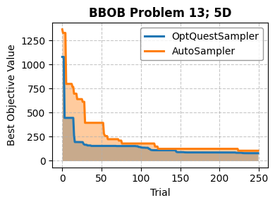
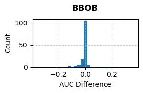
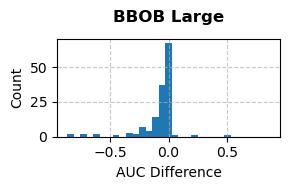
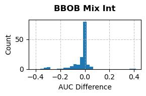
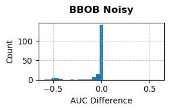
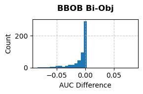
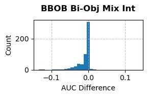
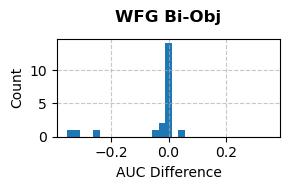
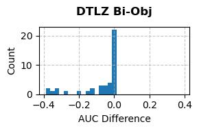
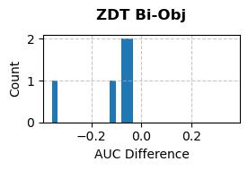

## Abstract

OptQuest is a black-box optimization engine from OptTek Systems, Inc., which has developed it since 1998. You declare the decision variables, the constraints and one or more objectives. The engine proposes values for the variables, your code evaluates them and returns the results, and the engine uses those results to propose the next values. The engine does not need gradients or a formula for the objective, and it does not assume that the objective is convex or smooth. The search combines linear and mixed-integer programming, a design of experiments, scatter search (a reference set of the best trial solutions, combined into new ones), local search, enumeration of small domains, and a Kriging metamodel. In one model you can use continuous, integer, discrete, categorical and permutation variables, the special purpose and structured variable types listed in [Coverage](#coverage-and-known-limitations), constraints on inputs and outputs, and one or more objectives.

## Commercial License

The OptQuest library can be used in conjunction with Optuna in demo/evaluation mode without a commercial license key. This mode is provided solely for testing, evaluation, and demonstration purposes. Any use in production environments, commercial deployments, or for generating results intended for business decision-making requires a valid commercial license key.

For licensing inquiries, purchasing a commercial license, obtaining a license key, or requesting additional information, please contact:

OptTek Systems, Inc.

Email: info@opttek.com

Website: https://www.opttek.com/optquest/

## APIs

> [!NOTE]
> The `OptQuestSampler` requires binaries that are not distributed on OptunaHub. Install the `optquest` python package separately from PyPI: `pip install optquest`

`OptQuestSampler(model=None, search_space=None, directions=None, seed=None, license='', statements=None)`

Exactly one of the following must be provided to define the optimization:

- `model`: a fully defined `OptQuestModel` (the typed, method-call API, `model.add_continuous_variable(...)`, etc). The sampler recovers its search space from the model's own `describe()` output, so it supports every variable type below, including `MIXTURE`.
- `search_space` + `directions`: plain Optuna primitives, a distributions dict and a list of `optuna.study.StudyDirection`. The simplest way to get started; only scalar (continuous/integer/discrete/categorical) variables are possible in this mode, because Optuna has no richer distribution types.
- `statements`: a list of emitter statement dicts (`[{"cmd": "CONTINUOUS", "name": "x", "min": -5, "max": 5}, {"cmd": "DAG", "name": "flow", "nodes": [...]}, ...]`), the **recommended way to use OptQuest's advanced variable types**. Every command the OptQuest engine supports (container/vector/matrix variables; permutations; special purpose variables like mixtures, sequences, assignments, partitions, DAGs, paths, ...; outputs, expressions, constraints, objectives) is supported declaratively, with no per-type code required.

Other parameters:

- `seed`: random seed for the sampler. Must be a positive integer if set: the engine only
  applies a random seed when it is greater than zero; `seed<=0` raises `ValueError` at
  construction.
- `license`: a license string for the underlying OptQuest engine. With an empty string, the engine runs in "demo" mode, which is limited to 50 iterations.

If you ask for more than 50 trials (`study.optimize(..., n_trials=N)` with `N > 50`) with no license, you do not get an error. When the run reaches the cap, the sampler gives a `UserWarning` that states the cap, prunes the trial that reached it, and calls `study.stop()`, so `study.optimize()` returns normally after 50 trials. With the default `n_jobs=1`, `study.trials` then holds the 50 completed trials and one pruned marker trial, and the warning appears once. With `n_jobs=N` and `N > 1`, each worker that is still running a trial when the run reaches the cap must resolve that trial, because the sampler cannot resolve a trial that another worker is running. `study.trials` can then hold the 50 completed trials and **up to `n_jobs` pruned marker trials**. The `UserWarning` still appears only once for each sampler. The run stops in the same way for the other reasons that the engine has no more solutions to propose: optimum found, maximum iterations or time, stopped by the user, LP success, all methods used, and others. So a licensed run in which the engine completes its search also stops with no error. Two reasons are not a normal end: an exception in the engine, and constraints that no solution can meet (or another reason that the engine cannot make a further solution). In these two cases the run also stops with no error, but the sampler gives a different `UserWarning` (once for each sampler) that states the reason and gives the last error message from the engine. You can then tell an engine failure in a licensed run apart from a normal end of the search.

`OptQuestSampler` supports `study.optimize(..., n_jobs=N)` with `N > 1`. All calls to the engine (submit or reject a completed trial, request the next solution) run under an internal lock, so two workers cannot submit the same solution or report the same warning twice. The sampler sends the result of each trial to the engine in `after_trial()`, when Optuna finishes the trial. This includes the last trials of a run, for which no later `sample_relative()` call occurs. If a submit or reject call fails (the engine returns `False`, and does not raise an exception), or if the engine cannot give an empty solution in which to record the result of an enqueued trial, the sampler gives a `UserWarning` that identifies the trial. The one exception is a trial that was in the study before you attached this `OptQuestSampler` instance. See "Enqueueing known points" below.

A parameter the objective suggests outside the declared search space (a `trial.suggest_*()` call for a name the sampler did not register) is sampled by Optuna's `RandomSampler` and has no variable in the OptQuest model: the sampler warns once per such name and records the trial's registered values and result without it. Declare every parameter the engine should search in `search_space`, `statements` or `model`.

## Example

The OptQuest sampler can be used in one of three ways. The **"Optuna way"** (`search_space`/`directions`) uses Optuna primitives and is the easiest way to get started, a drop-in replacement for any other Optuna sampler. The **declarative "OptQuest way"** (`statements`) uses the full OptQuest command set to define a model with access to every advanced variable type, outputs, and constraints, recommended once you need more than scalar box variables. The **typed "OptQuest way"** (`model`) accepts a model you already built with the method-call API.

### The Optuna Approach

Like many samplers, the OptQuest engine needs to know the search space before the objective function is called as well as the directions of the objective(s).

```python
import optuna
import optunahub


OptQuestSampler = optunahub.load_module(package="samplers/optquest")


def objective(trial):
    x = trial.suggest_float("x", -5, 10)
    y = trial.suggest_float("y", -5, 10)
    return x**2 + y**2, (x - 5) * (x - 5) + (y - 5) * (y - 5)


search_space = {
    "x": optuna.distributions.FloatDistribution(-5, 10),
    "y": optuna.distributions.FloatDistribution(-5, 10),
}

directions = [optuna.study.StudyDirection.MINIMIZE, optuna.study.StudyDirection.MINIMIZE]

study = optuna.create_study(
    sampler=OptQuestSampler.OptQuestSampler(
        search_space=search_space, directions=directions, license=""
    ),
    directions=directions,
)

study.optimize(objective, n_trials=50)
```

### The Declarative OptQuest Approach (recommended for advanced use)

In an OptQuest model you can declare variable types that Optuna does not have: permutations, mixtures, sequences, assignments, partitions, DAGs, paths, and more (see [Coverage](#coverage-and-known-limitations) for the full list). You can also declare constraints on inputs and outputs, and the engine applies them.

A structured variable becomes several Optuna parameters. For example, a DAG over N nodes becomes N·N integer parameters, one for each ordered pair of nodes. The N parameters that pair a node with itself are always 0, so N·(N-1) of them can change. A DAG over 4 nodes is 16 Optuna parameters, and 12 of them can change. To write a matching `trial.suggest_*()` call for each of these parameters is slow and easy to get wrong. With `sampler.wrap(sim)` you do not write these calls: `wrap()` makes every `trial.suggest_*()` call for you and gives `sim` a dict of natural Python values keyed by the variable names you declared: a number for a scalar, a list for a vector, a list of rows for a matrix, a dict keyed by item name for a permutation, sequence or mixture, and a dict keyed by `(from, to)` for a DAG's edges. Outputs work the same way in reverse: `sim` returns a dict keyed by the output names you declared (or `None` to reject the point), and `wrap()` validates it and routes each value to the right output.

```python
import optuna
import optunahub


OptQuestSampler = optunahub.load_module(package="samplers/optquest")

model = [
    {"cmd": "CONTINUOUS", "name": "x", "min": -5.0, "max": 10.0},
    {"cmd": "CONTINUOUS", "name": "y", "min": -5.0, "max": 10.0},
    {"cmd": "OUTPUT", "name": "out00"},
    {"cmd": "OUTPUT", "name": "out01"},
    {"cmd": "OBJECTIVE", "name": "obj00", "direction": "min", "expression": "out00"},
    {"cmd": "OBJECTIVE", "name": "obj01", "direction": "min", "expression": "out01"},
]

sampler = OptQuestSampler.OptQuestSampler(statements=model, license="")


def sim(params):
    x, y = params["x"], params["y"]
    return {"out00": x**2 + y**2, "out01": (x - 5) ** 2 + (y - 5) ** 2}


study = optuna.create_study(sampler=sampler, directions=sampler.directions)
study.optimize(sampler.wrap(sim), n_trials=50)
```

A model with a special purpose variable looks the same: no extra code for the new variable type, and `sim` receives it already decoded:

```python
model = [
    {"cmd": "DAG", "name": "flow", "nodes": ["A", "B", "C", "D"]},
    {"cmd": "OUTPUT", "name": "cost"},
    {"cmd": "OBJECTIVE", "name": "obj", "direction": "min", "expression": "cost"},
]

sampler = OptQuestSampler.OptQuestSampler(statements=model, license="")


def sim(params):
    edges = params["flow"]  # {("A", "A"): 0, ("A", "B"): 0/1, ...} for every ordered pair of nodes; the diagonal is always 0
    return {"cost": float(sum(edges.values()))}


study = optuna.create_study(sampler=sampler, directions=sampler.directions)
study.optimize(sampler.wrap(sim), n_trials=50)
```

Every trial that the engine proposes has a valid value for each special purpose variable. For example, a DAG value has no cycle, the components of a mixture sum to `sum_to` (to within floating-point rounding), and a full ranking of n components uses each rank from 1 to n once. Your objective does not need a constraint or a penalty for that structure. The engine uses a point that you enqueue, or a completed trial that is already in the study, with the values that you give. See [Enqueueing known points](#enqueueing-known-points).

#### Constraints

OptQuest supports arbitrary constraints on inputs and outputs. The engine checks a constraint that uses only ordinary decision variables before the trial runs, and with the default settings every trial that the engine generates meets it. A constraint that uses a value of a special purpose variable, such as `mix@a` or `dir@theta`, is checked after your function runs, as for an output. Your function can receive values that break the constraint, and the engine then marks the trial infeasible. The same applies to a constraint that uses a random variable. The values of an item selection variable and a budgeted selection variable are ordinary inputs, so the engine checks a constraint on them before the trial runs. For a constraint that uses outputs, the engine records how much each trial breaks the constraint, and uses that record to move the search toward feasible trials.

```python
model = [
    {"cmd": "CONTINUOUS", "name": "x", "min": -5.0, "max": 10.0},
    {"cmd": "CONTINUOUS", "name": "y", "min": -5.0, "max": 10.0},
    {"cmd": "OUTPUT", "name": "out00"},
    {"cmd": "OUTPUT", "name": "out01"},
    {"cmd": "OBJECTIVE", "name": "obj00", "direction": "min", "expression": "out00"},
    {"cmd": "OBJECTIVE", "name": "obj01", "direction": "min", "expression": "out01"},
    {"cmd": "CONSTRAINT", "name": "constraint1", "expression": "x < y+1"},
]
```

See [`optquest_statements_reference.md`](optquest_statements_reference.md) for the full `statements=` command reference: every `"cmd"` value, its fields, and the shape `sim` receives it in, including the special purpose and structured variable types. `_EMITTER_SPEC` inside the `optquest` package (`python -c "from optquest import load_spec; print(load_spec()['commands'].keys())"`) is the same information in machine-readable form.

### The Typed OptQuest Approach

If you already build models with the method-call API (`OptQuestModel()`, `model.add_continuous_variable(...)`), pass the built model directly; `OptQuestSampler` recovers the search space from it automatically, including the special purpose and container variable types.

```python
import optuna
import optunahub


OptQuestSampler = optunahub.load_module(package="samplers/optquest")


def sim(params):
    x, y = params["x"], params["y"]
    return {"out00": x**2 + y**2, "out01": (x - 5) ** 2 + (y - 5) ** 2}


model = OptQuestSampler.OptQuestModel()
model.set_license("")
model.add_continuous_variable("x", -5, 10)
model.add_continuous_variable("y", -5, 10)

model.add_output_variable("out00")
model.add_output_variable("out01")
model.add_minimize_objective("obj00", "out00")
model.add_minimize_objective("obj01", "out01")

sampler = OptQuestSampler.OptQuestSampler(model=model)
study = optuna.create_study(sampler=sampler, directions=sampler.directions)
study.optimize(sampler.wrap(sim), n_trials=50)
```

### Manual / advanced usage

`wrap()` is optional. You can make the `trial.suggest_*()` calls yourself, matching each Optuna-facing parameter name and distribution exactly (including any `"<name>@<key>"`-suffixed sub-parameters of a structured variable; call `sampler.suggest_all(trial)` once to see the shape, or inspect `sampler._space`). With `model=`/`statements=` construction, return a plain tuple/list of objective values in `directions` order instead of a dict. This is the "outputs and objectives added in matching order" convention from earlier releases, kept for backward compatibility. This only works when every declared output is an identity pass-through of exactly one objective; a model with an output that isn't linked to any objective (for example one read only by a `CONSTRAINT`) has no value in the returned tuple to give it, so the sampler raises `NotImplementedError`. Without the error, that output would stay NaN in every trial, and every trial would be infeasible. Use `sampler.wrap(sim)` instead for any model with a constraint-only or otherwise-unlinked output:

```python
def objective(trial):
    x = trial.suggest_float("x", -5, 10)
    y = trial.suggest_float("y", -5, 10)
    return x**2 + y**2, (x - 5) * (x - 5) + (y - 5) * (y - 5)


study = optuna.create_study(sampler=sampler, directions=sampler.directions)
study.optimize(objective, n_trials=50)
```

### Enqueueing known points

`study.enqueue_trial(params)` (Optuna's mechanism for injecting an already-known point instead of asking the sampler to propose one) is supported. An enqueued trial is sent to OptQuest as an externally-evaluated point once it completes (the same path a hand-loaded historical result would take), rather than being generated by the engine's own search. The engine re-issues such a point once from `create_solution()` with `is_evaluated()` set and its outputs intact; the sampler submits it back as-is, so no second trial is run for it:

```python
study.enqueue_trial({"x": 2.0, "y": 3.0})
study.optimize(sampler.wrap(sim), n_trials=50)
```

For a structured or special purpose variable (declared via `statements=`/`model=`), key the dict with the same flat `"<name>@<key>"` sub-parameter names `sampler.suggest_all(trial)`/`sampler._space` expose, e.g. `{"m@a": 0.5, "m@b": 0.25, "m@c": 0.25}` for a `MIXTURE` variable named `m` with components `a`, `b`, `c`. `wrap()`'s natural-value decoding (turning those flat sub-parameters into a single dict/list value) only runs on `suggest_*`, not on `enqueue_trial`, so an enqueued point is specified in the flat engine-facing shape rather than the natural decoded shape `sim` receives. The engine uses the values of a special purpose variable in an evaluated solution as given. So give values that the variable can have, for example mixture weights that sum to `sum_to`.

The sampler also sends a completed trial to the engine with no `enqueue_trial` call when the trial is already in study storage the first time that `sample_relative()` runs after you attach the sampler. Examples are a study that you resume with `optuna.load_study(storage=...)`, and a study in which a different sampler ran trials before you attached `OptQuestSampler`. The sampler gives each of these trials to OptQuest as an already-evaluated point, through the same `add_evaluated()` call that `enqueue_trial()` uses. The engine does not propose these points in its own search. When the engine gives such a point back, the sampler submits it with its results and does not run it again as a new trial. The sampler marks earlier `FAIL` and `PRUNED` trials as handled, does not send them to the engine, and gives no warning for them: the engine has no solution with which to reject them, and they are from before the sampler. So attach an `OptQuestSampler` instance only to a study whose earlier trials you want the engine to know about. If the study has trials from an unrelated run, the sampler sends those trials to the engine with no warning.

The sampler gives no warning only for trials from before the sampler. An `enqueue_trial()` call that you make during the current run is different. If that trial ends as `FAIL` or `PRUNED` before the engine gave a solution with which to reject it, the sampler gives a `UserWarning` that identifies the trial, as it does for any other trial result that does not reach the engine.

### Coverage and known limitations

You can declare every scalar, container (vector/matrix/ND), permutation and special purpose (for example choice, multi-choice, mixture, sequence, policy sequence, topological sequence, assignment, item/budgeted selection, partition, DAG, tree, path, angle, region, and the smooth types low-rank, time-series vector, B-spline, spline and Fourier) variable type. A statement with a variable type that the sampler does not know raises `NotImplementedError`.

#### What your function receives for sequence, policy sequence, selection, angle and DAG variables

- **`SEQUENCE`**: in a full ranking (`top_k` omitted, or `top_k` of n or more) the ranks are 1 to n. In a top-k ranking the first `top_k` components get the ranks 1 to `top_k`, and every other component gets `top_k` + 1.
- **`POLICYSEQUENCE`**: only the item scores (`name@<item>`) are Optuna parameters, because they are the inputs. The coefficient, contribution and confidence families (`name@<feature>`, `name@<feature>@contribution`, `name@<feature>@confidence` and `name@<item>@confidence`) are outputs that the engine computes, so they are not Optuna parameters.
- **`SELECTION` is an on/off gate over a group of variables.** It is not a choice among the members of the group. It is one Optuna parameter, `CategoricalDistribution([False, True])`. When it is `True`, the variables in the group take their values as usual. When it is `False`, the engine sets them to their lower bounds for that trial. `trial.params[name]` is that flag. With `wrap()`, your function gets the list of the names in the group when the gate is on, and `[]` when it is off. To choose k of n items, use `ITEMSELECTION` or `BUDGETEDSELECTION`.
- **`ANGLE` and the `SPHERICALANGLE` azimuth (`phi`)**: the engine reports these values in `[0, 360)` rather than in the range that you declare. The sampler subtracts 360 when necessary before Optuna gets the value, so `trial.params` always holds a value inside your distribution: for an angle declared `(-45, 45)` that the engine reports as `315.0`, `trial.params` holds `-45.0`. The engine reports the elevation (`SPHERICALANGLE`'s `theta`) as it is, and the sampler does not change it.
- **`DAG` and `TREE`**: with `wrap()`, your function gets a dict keyed by `(from, to)` tuples, with one entry for each ordered pair of nodes. The entry for a node paired with itself is always 0.

#### What the sampler does not support

- **The Optuna distribution for an `EXCLUSIVE` range** (a sub-range removed from the domain of a variable): Optuna has no distribution with a gap in it, so the Optuna distribution for the variable covers the full declared range. The engine applies the exclusion to the values that it proposes.
- **Random variables** (the `*RANDOM` commands): the sampler raises `NotImplementedError` for them. They are random values that the engine draws rather than decision inputs or outputs that you set.

## Performance

We measure the performance of a sampler with an area-under-the-curve (AUC) metric.

### How the AUC is computed

The AUC depends on two things: how close the best value found is to the best-known value, and how early in the run the sampler finds it. In the figure, we plot the best value found so far against the trial number for problem 13 of the 5-dimensional BBOB suite, over 250 trials. The objective is minimized. For most of the 250 trials, the best value that OptQuestSampler has found is lower than the best value that AutoSampler has found. The AUC is the area under this curve.



To compute the AUC, we scale the trial numbers to the interval [0, 1]. We scale the objective values so that the best-known value from the two samplers is 0 and the worst-known value is 1. The AUC is then between 0 and 1. An AUC of 0 means that the sampler found the best-known value on the first trial. An AUC of 1 means that the sampler found no improvement during the run. A lower AUC is better.

In this example, the AUC is 0.017 for OptQuestSampler and 0.038 for AutoSampler. The ratio 0.038 / 0.017 is 2.2x. A ratio of 1.0x would mean that the two samplers have the same AUC.

For a multi-objective problem, we record the Pareto frontier at each trial instead of one best value, and we add up the area that the frontier does not dominate. For problems with many objectives, we use the hypervolume instead of the area. A lower AUC means that the sampler found a better frontier earlier.

The rationale for this metric is in this paper: Thengvall, B.G., Hall, S.N. & Deskevich, M.P. Measuring the effectiveness and efficiency of simulation optimization metaheuristic algorithms. *J Heuristics* **31**, 12 (2025). https://doi.org/10.1007/s10732-025-09549-2

### Results on the Optuna benchmark suites

A result on one problem is not sufficient to compare two samplers, and no sampler is better than all others on all problems. For each problem in the suites below, we computed the AUC difference: the OptQuestSampler AUC minus the AutoSampler AUC. A negative difference means that OptQuestSampler had the smaller AUC on that problem. A difference of 0 means that the two samplers had the same AUC. Each histogram is the distribution of the AUC differences for all the problems in one suite. Each single-objective run used 500 trials, and each multi-objective run used 5,000 trials.

| Test Suite                      | Functions  | Dimensions                  | AUC Difference Distribution                                                    |
| ------------------------------- | ---------- | --------------------------- | ------------------------------------------------------------------------------ |
| BBOB                            | [1..24]    | [2, 3, 5, 10, 20, 40]       |                                          |
| BBOB Large Scale                | [1..24]    | [20, 40, 80, 160, 320, 640] |                   |
| BBOB Mixed Integer              | [1..24]    | [5, 10, 20, 40, 80, 160]    |                     |
| BBOB Noisy                      | [101..130] | [2, 3, 5, 10, 20, 40]       |                              |
| BBOB Bi-objective               | [1..92]    | [2, 3, 5, 10, 20, 40]       |                       |
| BBOB Bi-objective Mixed Integer | [1..92]    | [5, 10, 20, 40, 80, 160]    |  |
| WFG                             | [1..7]     | [3,5,7]                     |                                      |
| DTLZ                            | [1..7]     | [3, 5, 7, 10, 13, 15]       |                                    |
| ZDT                             | [1..6]     | n/a                         |                                      |

To test OptQuest on your own problems, ask OptTek for a trial license (see [Commercial License](#commercial-license)).
