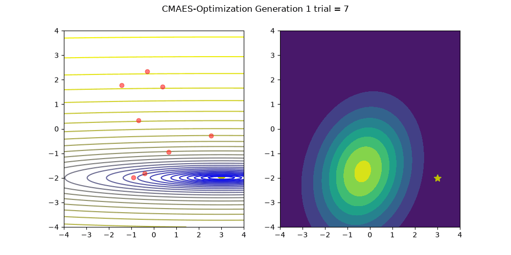
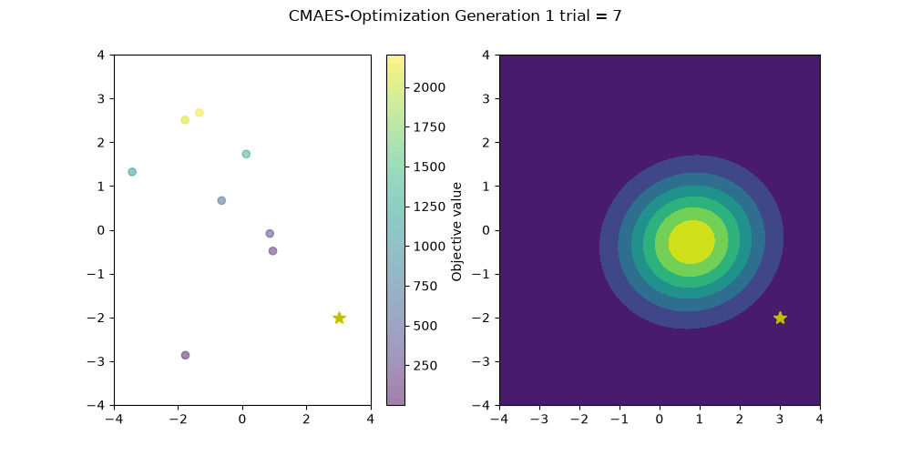

## Abstract

This package provides an animation of CMA-ES optimization in an Optuna study. It restores the `cmaes.CMA optimizer state` that `~optuna.samplers.CmaEsSampler` stores in `trial.system_attrs` and draws the sampled trials and the corresponding multivariate normal distribution `N(m, σ²C)` for each available optimizer snapshot. You can watch the mean move toward the optimum and the distribution change its size and shape. The visualization is adapted from tools/cmaes_visualizer.py of CyberAgentAILab/cmaes .

## APIs

-`plot_cmaes(study, params=None, target=None, contour_function=None, interval=500)`

- `study`: A single-objective study optimized with the default : class: `~optuna.samplers CmaEsSampler.`
- `params`: The names of the two parameters to plot. If None, the parameters of the completed trials are used.
- `target`: A callable that accepts a `FrozenTrial` and returns a scalar value used to color sampled points when no contour function is provided. Defaults to `trial.value`.
- `contour_function`: Optional function `f(x1, x2)` drawn as contour lines. Optuna does not know the objective function, so this is only useful for experiments where it is known.
  -`interval`: Delay between frames in milliseconds.
- Returns a `matplotlib.animation.FuncAnimation`

**Example**

```python
import numpy as np
import optuna
import optunahub

mod = optunahub.load_module(
    package="visualization/plot_cmaes",
)

plot_cmaes = mod.plot_cmaes

def objective(trial: optuna.trial.Trial) -> float:
     """Quadratic function"""

     x1 = trial.suggest_float("x1", -4, 4)
     x2 = trial.suggest_float("x2", -4, 4)

     return (x1 - 3) ** 2 + (10 * (x2 + 2)) ** 2

def quadratic_contour(x1 : np.ndarray, x2 : np.ndarray) -> np.ndarray:
    """Contour function representing the objective landscape."""

    return np.log(((x1 - 3) ** 2 + (10 * (x2 + 2)) ** 2) + 1)

if __name__ == "__main__":
    sampler = optuna.samplers.CmaEsSampler()
    study = optuna.create_study(sampler = sampler )
    study.optimize(objective, n_trials=250)

    # With Known Contour Function
    animation_with_contour_function = plot_cmaes(study,contour_function = quadratic_contour)
    animation_with_contour_function.save("Cmaes_contour_function.gif", writer = "pillow")
   

    # without Contour Function
    animation_without_contour_function = plot_cmaes(study)
    animation_without_contour_function.save("Cmaes_without_contour_function.gif", writer = "pillow")
    

```

## CMA-ES Plot

With a Known Contour Function



Without a known Contour Function



## Installation

```shell
pip install -r https://hub.optuna.org/visualization/plot_cmaes/requirements.txt
```

## Current Scope and Limitations

- Supports 2-dimensional continuous `FloatDistribution` parameters only.
- Log-scaled and stepped distribution are not supported.
- Requires the study to use the default : class:`~optuna.sampler.CmaEsSampler`.
- Restart strategies `ipop/bipop`, Separable CMA-ES `use_separable_cma = True`, and CMA-ES with Margin `with_margin = True` are not supported currently and will raise a ValueError.

## Credits

This Visualization is adapted from the cmaes_visualizer.py of CyberAgentAILab/cmaes.
The original project is distributed under MIT License. See the included LICENSE file for copyright and license information.

## Reference

Masahiro Nomura, Masashi Shibata, Ryoki Hamano. cmaes: A Simple yet Practical Python Library for CMA-ES https://arxiv.org/abs/2402.01373
